<p align="center">
  
</p>

<p align="center">
  
</p>

<p align="center"><b>Infrastructure & networking is my core.</b> I can build an organization's IT foundation from scratch — from bare metal to a secure, working network.</p>

<p align="center">
  
</p>

**LV1 · Mining** — I left school after grade 9 (Mathayom 3) and got into crypto mining, building rigs up to 50 RTX 30-series GPUs. That's how I learned PC hardware and networking.

**LV2 · Proxmox** — I set up Proxmox to rent out CPU-only VMs, with each renter locked to a fixed slice of resources. I still rent compute through crypto networks today.

**LV3 · GPU Rental** — Then I moved into AI compute rental. Mining only needs a PCIe x1 slot per card, but AI needs a lot of lanes — so I moved the same GPUs onto dual-socket Xeon server boards with 80 PCIe lanes. At its peak the cluster had 368 GB of VRAM.

**LV4 · Exit** — Power costs stopped making sense, and decentralized AI renters didn't want many 30-series cards — they're not strong enough for training. So I sold all the GPUs and RAM, and made a 3× profit on the RAM.

**LV5 · Team** — Now I'm building a small organization with my friends, and I keep running everything I've learned in my homelab.

**Side quest · AI** — I use AI heavily. I've used it since it was just a chat box, and now I work with AI agents every day.

---

<p align="center">🏠 <i>Everything below is designed, built and run by me in my own <b>homelab</b>.</i></p>

### 🏢 Organization-grade IT, built at home

```text
Internet ─► OPNsense firewall ─► VLANs (Prod · Dev · Sandbox · DMZ) ─► Proxmox cluster ─► Services · AI cameras · Backups
                    │
                    └─► WireGuard VPN ─► Secure remote access
```

- Plan and set up the **whole stack**: internet uplink → firewall → network zones → servers → services
- Separate zones and workloads with **VLANs** and firewall policies
- Run all servers on a **Proxmox** virtualization cluster
- Provide **secure remote access** for users through VPN
- Harden the network and control who can access what

### 🖥️ Infrastructure — Proxmox

- Multi-node **Proxmox VE clusters** — design, deployment and day-to-day operation
- High-speed **40GbE** interconnects between nodes
- VM / container lifecycle, templates, resource pools and access control
- **Backup & restore** — scheduled backups of VMs / containers, tested restores and disaster recovery
- **Infrastructure-as-Code** for provisioning with Terraform
- Hardware selection, benchmarking and troubleshooting (CPU, RAM, NVMe, NIC, UPS)

### 🌐 Networking

- Network design with **VLAN segmentation** — production, sandbox, dev and DMZ zones
- **OPNsense** firewall & routing — rules, NAT, inter-VLAN routing, DHCP/DNS
- OPNsense as the **VPN gateway** for remote users
- **VPN & tunneling** — WireGuard, site-to-site and remote access
- Multi-region network nodes and performance tuning (TCP / BBR)
- Security hardening — IDS/IPS (Suricata), CrowdSec, Cloudflare Tunnels & DNS

### 🎥 AI camera system

- Self-hosted CCTV / NVR running on my own servers
- **AI object detection** — detects people and objects on camera in real time
- Cameras isolated on their own VLAN behind the firewall

### ⚙️ Also

- 🌐 **Full-stack development** — frontend, backend, database, auth
- ⚙️ **Backend & automation** — APIs, monitoring services, background workers
- 📊 **Data & finance** — data analysis and financial modeling

### 🛠️ Tech stack

**Infrastructure & Networking**<br/>


**Languages**<br/>


**Web & Backend**<br/>


**Tools**<br/>


---

### ⚖️ Strengths & weaknesses

**Strengths**
- **How I learn** — My biggest strength is how I learn. I'm curious about everything, and I get good at things by working on real problems, not by reading about them.
- **Self-taught, outside the box** — I teach myself fast and don't need a textbook to get started. I'm always finding something to build, I push it as far as it can go, and when there's no obvious way, I find one.

**Weaknesses**
- **Theory** — Pure theory without practice is hard for me. To deal with that, I built my own homelab, so I can learn the theory while I'm actually building.
- **Limited cloud experience** — I've only tried AWS briefly. Most of it maps to what I already run on Proxmox (VMs, networks, storage), just with different names, so I expect to pick it up quickly.
- **Over-engineering (a little)** — The flip side of that drive: I sometimes build way more than the job needs. A simple setup somehow ends up with VLANs, a cluster and monitoring. 😅

I'm self-aware enough to know my weak spots, and I'm quick to adjust when something isn't working. My weaknesses aren't the whole picture: given the chance to learn and grow, I adapt fast.

<p align="center">
  
</p>
